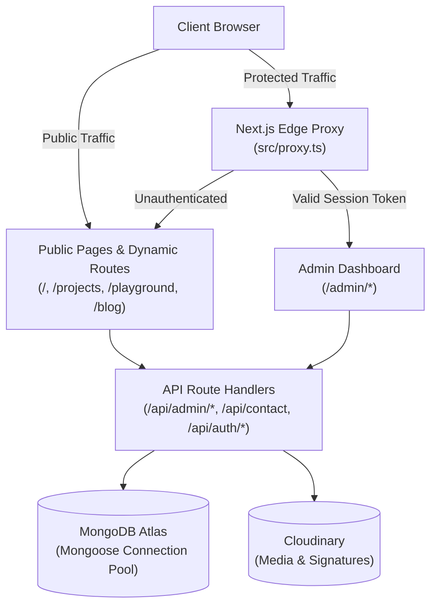

# Shahid Hasan Shuvo — Full-Stack Developer Portfolio

[](https://nextjs.org/)
[](https://react.dev/)
[](https://www.typescriptlang.org/)
[](https://tailwindcss.com/)
[](https://www.mongodb.com/)
[](https://github.com/mrshanshuvo/shahidhasanshuvo/actions)
[](./License)

A modern, high-performance personal portfolio and content management system built with Next.js 16, React 19, Auth.js v5, and MongoDB Atlas. Features an interactive public showcase with cinematic UI animations, server-rendered dynamic routes, comprehensive SEO, and a protected administrative dashboard.

**Live Deployment:** [https://shahidhasanshuvo.vercel.app](https://shahidhasanshuvo.vercel.app)

---

## Architecture Overview



---

## Key Features

### 🌟 Public Showcase

- **Cinematic Hero & Bio**: Custom cursor, smooth scrolling, ambient aurora mesh gradients, and Markdown-rendered biography.
- **Relational Project Showcase**: Filter projects by categories and technologies with responsive media galleries (image, video, embeds).
- **Interactive Playground / Experiments**: Real-time demos with dynamic routing (`/playground/[slug]`).
- **Technical Stack & Brand Registry**: Interactive skill matrix connected to normalized database technology documents.
- **Inquiry & Contact System**: Protected contact form equipped with Google reCAPTCHA v3 bot scoring, honeypot detection, and automated SMTP notifications.
- **Dynamic SEO & Metadata**: Canonical metadata base, dynamic OpenGraph/Twitter social cards, automated `robots.txt`, and dynamic `sitemap.xml`.

### 🛡️ Administrative Dashboard (`/admin`)

- **Role-Based Content Management**: Full CRUD over Projects, Demos, Experiences, Educations, Certifications, Skills, Technologies, and Social Links.
- **Secure Authentication**: Auth.js v5 JWT credentials strategy with bcrypt hashing, password reset tokens, and time-bound 6-digit OTP verification.
- **Cloudinary Media Manager**: Direct asset uploads and server-signed upload signatures.
- **Site Settings & Controls**: Manage site name, description, hireable badges, accent themes, and maintenance mode in real-time.
- **Visitor Analytics**: Daily visitor counter and 7-day sparkline trend visualization.

---

## Tech Stack

| Domain             | Technology                                                                                    |
| :----------------- | :-------------------------------------------------------------------------------------------- |
| **Framework**      | [Next.js](https://nextjs.org/) 16.2.7 (App Router, Server Components, Edge Proxy)             |
| **UI Library**     | [React](https://react.dev/) 19.2.5                                                            |
| **Styling**        | [Tailwind CSS](https://tailwindcss.com/) v4, `@base-ui/react`, `framer-motion`, `react-icons` |
| **Language**       | [TypeScript](https://www.typescriptlang.org/) 5.9.3                                           |
| **Database**       | [MongoDB Atlas](https://www.mongodb.com/atlas) with [Mongoose](https://mongoosejs.com/) 9.5.0 |
| **Authentication** | [Auth.js / NextAuth](https://authjs.dev/) 5.0.0-beta.31 & `bcryptjs`                          |
| **State & Data**   | [TanStack React Query](https://tanstack.com/query) v5                                         |
| **Media & CDN**    | [Cloudinary](https://cloudinary.com/) Node SDK                                                |
| **Email Service**  | [Nodemailer](https://nodemailer.com/) (SMTP / Gmail App Passwords)                            |
| **Bot Protection** | Google reCAPTCHA v3                                                                           |
| **Quality & CI**   | Prettier (with Tailwind plugin), ESLint v9, GitHub Actions                                    |

---

## Directory Structure

```text
shahidhasanshuvo/
├── .github/
│   └── workflows/ci.yml           # Automated CI pipeline (lint, format, typecheck, build)
├── public/                        # Static assets (favicons, CV PDF, badges)
├── src/
│   ├── app/
│   │   ├── (admin)/admin/         # Authenticated admin dashboard & sub-pages
│   │   ├── (auth)/                # Authentication views (/login, /reset-password)
│   │   ├── (public)/              # Public portfolio routes (/, /projects, /playground, /blog)
│   │   ├── api/                   # RESTful API route handlers
│   │   ├── components/            # Reusable UI, Layout, Analytics, & Section components
│   │   ├── globals.css            # Tailwind CSS v4 directives & theme variables
│   │   ├── layout.tsx             # Root layout with providers & dynamic metadata
│   │   ├── not-found.tsx          # Custom 404 error page
│   │   ├── error.tsx              # Custom runtime error boundary
│   │   ├── robots.ts              # Automated search engine crawler rules
│   │   └── sitemap.ts             # Dynamic sitemap indexer for projects & demos
│   ├── components/ui/             # Base UI and Shadcn design system components
│   ├── lib/                       # Database connector, Auth config, Cloudinary, icon registry
│   ├── models/                    # Mongoose schemas with compound indexes
│   ├── proxy.ts                   # Next.js 16 Edge proxy for session validation
│   ├── scripts/                   # Database migration and utility scripts
│   └── types/                     # TypeScript shared interfaces and schemas
├── .env.example                   # Sanitized environment template
├── next.config.ts                 # Webpack configuration & HTTP security headers
├── package.json                   # Dependencies, scripts, and package manager config
└── tsconfig.json                  # Strict TypeScript configuration
```

---

## Getting Started

### Prerequisites

Ensure you have the following installed:

- **Node.js**: v20 or v22 LTS
- **pnpm**: v10+ (or v12)
- **MongoDB**: A local instance or a free [MongoDB Atlas](https://www.mongodb.com/atlas) cluster

### 1. Clone the Repository

```bash
git clone git@github.com:mrshanshuvo/shahidhasanshuvo.git
cd shahidhasanshuvo
```

### 2. Install Dependencies

```bash
pnpm install
```

### 3. Configure Environment Variables

Copy the example environment template:

```bash
cp .env.example .env.local
```

Open `.env.local` and provide your credentials:

```env
# Public Site Configuration
NEXT_PUBLIC_SITE_URL="http://localhost:3000"

# Database (MongoDB Atlas)
MONGODB_URI="mongodb+srv://<username>:<password>@cluster0.mongodb.net/portfolio?retryWrites=true&w=majority"

# NextAuth / Auth.js
NEXTAUTH_URL="http://localhost:3000"
NEXTAUTH_SECRET="generate-a-random-secret-key-with-openssl"

# Google reCAPTCHA v3
NEXT_PUBLIC_RECAPTCHA_SITE_KEY="your-recaptcha-site-key"
RECAPTCHA_SECRET_KEY="your-recaptcha-secret-key"

# Email Notifications (Nodemailer / Gmail App Password)
EMAIL_USER="your-email@gmail.com"
EMAIL_PASS="your-16-char-app-password"

# Cloudinary
CLOUDINARY_CLOUD_NAME="your-cloud-name"
CLOUDINARY_API_KEY="your-api-key"
CLOUDINARY_API_SECRET="your-api-secret"
```

### 4. (Optional) Run Technology Relational Migration

If your database contains legacy technology strings, normalize them into relational `Technology` documents:

```bash
pnpm migrate:tech
```

### 5. Launch the Development Server

```bash
pnpm dev
```

Visit [http://localhost:3000](http://localhost:3000) to view the site, or [http://localhost:3000/admin](http://localhost:3000/admin) to access the admin panel.

---

## Available Scripts

| Command             | Description                                                            |
| :------------------ | :--------------------------------------------------------------------- |
| `pnpm dev`          | Starts the Next.js dev server with Webpack compilation (`--webpack`).  |
| `pnpm build`        | Compiles the production build with static generation and optimization. |
| `pnpm start`        | Serves the production build.                                           |
| `pnpm lint`         | Runs ESLint over the entire codebase.                                  |
| `pnpm lint:fix`     | Automatically fixes auto-fixable ESLint issues.                        |
| `pnpm typecheck`    | Validates TypeScript types across all files without emitting output.   |
| `pnpm format`       | Formats all files with Prettier and sorts Tailwind CSS classes.        |
| `pnpm format:check` | Checks formatting compliance across all files.                         |
| `pnpm migrate:tech` | Runs the Mongoose migration script for technology foreign keys.        |

---

## Security & Reliability Engineering

- **Edge Proxy Route Isolation**: [`src/proxy.ts`](./src/proxy.ts) validates signed session cookies at the network edge before requests touch server components or database layers.
- **XSS Sanitization**: Dynamic user input is HTML-escaped before Markdown transformation, disarming stored and DOM-based cross-site scripting attacks.
- **Input Validation & Anti-Spam**: Contact form submissions are validated with strict length constraints, honeypot fields, and Google reCAPTCHA v3 score thresholds ($\ge 0.5$).
- **HTTP Security Headers**: Enforces strict browser-level protections in [`next.config.ts`](./next.config.ts):
  - `X-Content-Type-Options: nosniff`
  - `X-Frame-Options: SAMEORIGIN`
  - `Referrer-Policy: strict-origin-when-cross-origin`
  - `X-DNS-Prefetch-Control: on`
  - `Permissions-Policy: camera=(), microphone=(), geolocation=()`

---

## Continuous Integration (CI)

Every pull request and push to `main` triggers our GitHub Actions pipeline ([`.github/workflows/ci.yml`](./.github/workflows/ci.yml)):

1. **Prettier Format Check**: Ensures clean styling and canonical Tailwind class sorting.
2. **ESLint Verification**: Validates Next.js Core Web Vitals and React 19 standards.
3. **TypeScript Typecheck**: Executes `tsc --noEmit` to catch typing regressions.
4. **Full Production Build**: Verifies that all static routes and dynamic pages compile cleanly.

---

## Author

**Shahid Hasan Shuvo**  
Full-Stack Developer & Machine Learning Enthusiast

- Website: [shahidhasanshuvo.vercel.app](https://shahidhasanshuvo.vercel.app)
- GitHub: [@mrshanshuvo](https://github.com/mrshanshuvo)
- Email: [shahidhasanshovu@gmail.com](mailto:shahidhasanshovu@gmail.com)

---

## License

This project is licensed under the [MIT License](./License).
